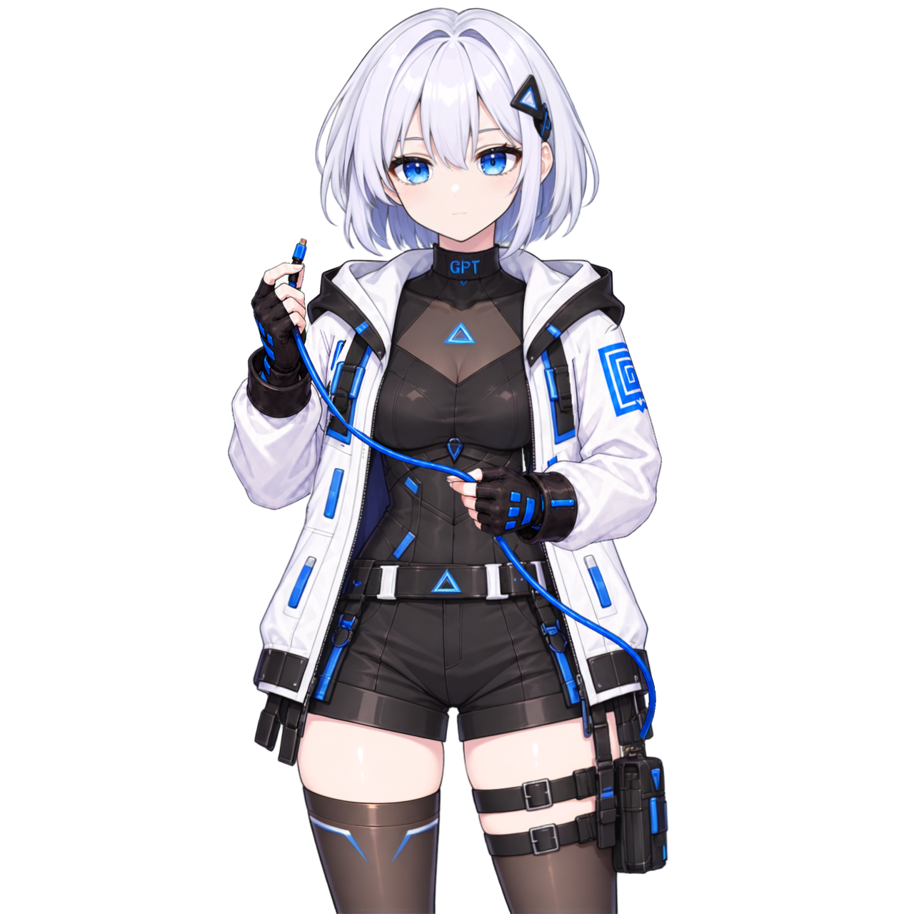

# Daemonlet for Codex

**한국어** · [English](README.en.md)

**Codex 작업에 반응하고, 말풍선으로 대화하는 데스크톱 캐릭터.**

작업 상태에 따라 포즈와 말풍선이 바뀌며, 로컬 AI 모델로 캐릭터와 직접 대화하고 답변을 음성으로 들을 수 있는 앱입니다. **Dots 연결**을 별도로 설정하면 Dots가 도구로 보낸 문장·표정·상태도 표시합니다. 기본 캐릭터 **지피쨩**과 함께 시작하고, 외부 `.petchar` 팩으로 다른 캐릭터를 추가할 수 있습니다.

OpenAI의 공식 제품이나 제휴 제품이 아닙니다.



## 다운로드 — v0.8.5

| 환경 | 다운로드 | 안내 |
|---|---|---|
| macOS · Apple Silicon | [Mac ZIP](https://github.com/ddol2ya/DAEMONLET/releases/download/v0.8.5/Daemonlet-for-Codex-0.8.5-macOS-arm64.zip) | macOS 13 이상 · Developer ID 서명·Apple 공증 완료 |
| Windows · x64 | [설치 프로그램](https://github.com/ddol2ya/DAEMONLET/releases/download/v0.8.5/Daemonlet-for-Codex-0.8.5-windows-x64-Setup.exe) | Windows 10 build 19045 이상 · 현재 사용자용 · 미서명 |
| Windows · x64 | [압축판 ZIP](https://github.com/ddol2ya/DAEMONLET/releases/download/v0.8.5/Daemonlet-for-Codex-0.8.5-windows-x64.zip) | 설치 없이 폴더 전체를 압축 해제 후 실행 · 미서명 |

[릴리즈 안내·검증 범위](https://github.com/ddol2ya/DAEMONLET/releases/tag/v0.8.5) · [파일 확인용 SHA-256](https://github.com/ddol2ya/DAEMONLET/releases/download/v0.8.5/SHA256SUMS.txt) · [빌드 출처](https://github.com/ddol2ya/DAEMONLET/releases/download/v0.8.5/SOURCE-PROVENANCE.json)

일반 앱 실행에는 별도 Node.js, Python, ComfyUI 또는 수동 서버 설치가 필요하지 않습니다. **로컬 캐릭터챗과 음성 TTS의 모델은 앱에서 각각 별도로 설치합니다.** Windows GGUF 실행 환경은 배포본에 포함되며, 선택한 모델은 별도로 다운로드합니다. Mac Qwen과 기존 Windows PyTorch 설치는 전용 Python 환경도 준비합니다. 작업 상태 표시와 기존 클릭 반응에는 모델이 필요하지 않습니다. **Dots 연결만 별도 Node.js·공식 tunnel-client·계정 설정이 필요합니다.** Windows 파일은 게시자 서명을 검증할 수 없는 미서명 배포이며, SHA-256은 배포 파일의 일치 여부를 확인합니다.

## v0.8.5 주요 변경

- **Windows 로컬챗 CUDA·Vulkan:** 하나의 앱에 두 실행기를 포함하고, `자동 / CUDA / Vulkan`을 선택할 수 있습니다. 자동 모드는 CUDA를 우선 확인하고 필요하면 Vulkan을 사용합니다.
- **음성 GPU 자동 선택:** Qwen·Vox GGUF에서 대화와 별도로 실행 방식을 선택합니다. 자동 파일 준비는 두 런타임을 함께 준비하고 모델을 공유합니다.
- **GPU 세대 제한 제거:** GGUF CUDA 음성의 compute capability 8.9 고정 검사를 제거했습니다. 드라이버·파일 무결성·실제 GPU 로딩 검사는 유지합니다.
- 기존 대화, 목소리, 수동 실행 방식과 외부 모델 연결을 보존합니다. Windows 실기 검증 장치는 RTX 4090이며 다른 GPU의 정상 동작을 보장하지 않습니다.

[릴리즈 상세·검증 범위](https://github.com/ddol2ya/DAEMONLET/releases/tag/v0.8.5)

## 빠르게 시작하기

1. 운영체제에 맞는 앱을 다운로드합니다.
   - **Mac:** ZIP을 풀고 `Daemonlet for Codex.app`을 응용 프로그램 폴더로 옮깁니다.
   - **Windows:** 설치 프로그램을 실행합니다. ZIP판은 폴더 전체를 압축 해제합니다.
2. **Daemonlet for Codex**를 실행합니다. 기본 캐릭터 지피쨩이 표시됩니다.
3. 원하는 기능을 선택합니다.
   - **로컬 대화:** 캐릭터 우클릭 또는 메뉴바·트레이에서 **로컬 캐릭터 대화**를 열고 **Daemonlet 설정 → 대화·음성**에서 모델을 설치한 뒤 질문합니다. Codex 로그인이나 부모 대화 선택은 필요하지 않습니다.
   - **음성으로 듣기:** **설정 → 대화·음성 → 캐릭터 음성**에서 엔진을 선택하고 **필요한 파일 받기·연결**을 누릅니다. 목소리를 선택한 뒤 캐릭터챗을 열고 **음성 사용**을 켜 **시험 재생**으로 확인합니다. Qwen은 사용 권한이 있는 WAV가 필요합니다.
   - **작업 상태 표시:** 같은 사용자 계정의 **Codex 데스크톱 앱**에서 작업을 시작합니다.
   - **Dots 출력:** **설정 → Dots 연결 → Dots 연결 마법사 열기**에서 별도 연결을 준비합니다. 아래 [Dots 연결](#dots-연결--선택-사항)의 설치·권한·출력 시험을 확인하세요.

**데스크톱 연결에는 CLI Hook 설치가 필요하지 않습니다.**

자세한 설치·복구·제거 방법: [Mac 안내](docs/install-macos.md) · [Windows 안내](docs/install-windows.md)

| 기능 | 연결·모델 | 하는 일 |
|---|---|---|
| Codex 작업 연동 | 같은 사용자 계정의 Codex 데스크톱 앱 | 작업 상태·사용량 표시, 선택한 작업 제어 |
| 로컬 캐릭터 대화 | 별도 설치한 로컬 대화 모델 | 캐릭터와 직접 대화 · 파일·셸·MCP 도구 실행 없음 |
| Codex 작업 대화 · Side Chat | 공식 CLI·로그인·선택한 부모 대화 | 완료된 작업 맥락을 설명 · Codex 사용량 발생 가능 |
| Dots 연결 | 별도 터널·개인 플러그인 | 명시적으로 전달한 문장·표정·상태 표시 및 선택적 로컬 음성 |

## 주요 기능

- **로컬 캐릭터챗:** 캐릭터 옆 말풍선에서 대화하며 답변 스트리밍·중단·다시 답하기를 지원합니다.
- **음성 TTS · 시험기능:** 답변 자동 읽기·다시 읽기·음성만 중단과 청크/완성 후 재생을 지원합니다.
- **Vox·Qwen·WAV:** Windows GGUF CUDA/Vulkan, Mac Metal/MLX와 사용 권한이 있는 WAV 기준 음성·호환 Vox 학습팩을 지원합니다.
- **Dots 연결:** 연결 마법사로 개인 터널을 준비하고 `present`·`cancel` 도구로 출력을 전달·중단합니다.
- **오디오 립싱크:** 지원 팩의 입을 실제 재생 오디오 크기에 맞춰 움직입니다. Belle 1.2.3은 37포즈를 지원합니다.
- **대화·음성 설정:** 로컬 모델, 음성 설치·연결, 재생 방식과 음량을 설정 창에서 관리합니다.
- **대화 관리:** 캐릭터별 대화 저장·재개·삭제와 사용자가 명시적으로 저장한 기억 관리를 지원합니다.
- **대화 포즈·모션:** 팩의 감정·제스처 설정에 맞춰 반응하고 다음 대화 전까지 마지막 답변 자세를 유지합니다.
- **작업 상태 표시:** Codex 작업에 맞춰 포즈와 작업 말풍선이 바뀝니다.
- **캐릭터와 상호작용:** 머리·몸통 클릭과 쓰다듬기를 지원합니다.
- **표시 설정:** 캐릭터의 크기·위치·불투명도와 클릭 통과, 말풍선 표시를 조절할 수 있습니다.
- **캐릭터 추가:** 외부 `.petchar` 팩을 가져와 사용할 수 있습니다.
- **로딩 안내:** 캐릭터 가져오기와 앱 시작 시 준비 상태를 표시합니다.
- **Mac 음성 입력:** 한국어·영어 받아쓰기로 Codex에 보낼 문장을 입력할 수 있습니다.

**v0.7.1부터** **설정 → 언어 / Language** 또는 트레이 메뉴에서 한국어·영어를 선택할 수 있습니다. 선택은 저장되며 모든 앱 창에 즉시 적용됩니다. Mac 받아쓰기는 다음 녹음부터 선택 언어를 사용하고, 작성 중인 문장은 보존합니다. 캐릭터 이름과 대사는 팩의 원문을 유지하며, macOS 권한 창은 시스템 언어 설정을 따릅니다. Windows 받아쓰기는 지원하지 않습니다.

## 로컬 캐릭터챗

캐릭터 우클릭 또는 메뉴바·트레이의 **로컬 캐릭터 대화**를 선택하세요. 캐릭터 옆에 메신저 형태의 말풍선이 열립니다.

1. **설정 → 대화·음성 → 로컬 대화 모델**에서 **Gemma 4 E4B / 12B** 중 하나를 선택해 설치합니다. 다운로드·이어받기·중단·파일 검증을 지원하며, 정확히 일치하는 공식 GGUF 파일을 직접 가져올 수도 있습니다. 모델은 자동으로 다운로드하지 않습니다.
2. 메시지를 보내면 대사가 스트리밍으로 표시됩니다. 생성 중 중단 버튼으로 멈추고 다음 질문을 보낼 수 있습니다.
3. 말풍선 상단 **···**에는 **캐릭터 선택과 저장된 대화 불러오기**만 있습니다. 새 대화·다시 답하기·삭제, 모델·음성·기억 관리는 **설정 → 대화·음성**에서 합니다. 빈 새 대화는 첫 메시지를 보낼 때 저장됩니다.
4. 말풍선 상단을 끌어 위치를 옮기고 오른쪽 아래 손잡이로 크기를 조절합니다. 위치와 크기는 재실행 후에도 유지됩니다.

**설정 → 대화·음성 → 대화 GPU 실행 방식**에서 자동·CUDA·Vulkan을 선택합니다. 음성의 실행 방식은 별도로 선택하며, Vulkan에는 NVIDIA R580 드라이버 조건을 적용하지 않습니다.

모델 설치 후 **대사 생성은 로컬에서 실행**됩니다. 유료 외부 평가·채팅 API를 사용하지 않으며, 파일 수정·셸·MCP 도구 실행 권한을 제공하지 않습니다. 음성 TTS를 켜면 확정된 답변을 별도 로컬 음성 엔진으로 읽습니다.

| 실행 환경 | 로컬 캐릭터챗 경로 |
|---|---|
| Mac · Apple Silicon | Metal |
| Windows · x64 | CUDA / Vulkan · 자동 또는 직접 선택 |

두 플랫폼에서 E4B·12B 런타임의 연속 대화·중단·복구를 확인했습니다. 이전 [0.8.2 검증](https://github.com/ddol2ya/DAEMONLET/releases/tag/v0.8.2)에는 Mac 공증본과 Windows 정식 설치 프로그램의 실제 업그레이드·설정·대화 보존·음성 동작이 포함됩니다. **최소 메모리·VRAM 사양은 확정하지 않았으며**, Intel Mac이나 Windows AMD/Intel GPU를 검증된 경로로 안내하지 않습니다. 최신 앱의 검증 범위와 남은 점은 [0.8.5 릴리즈 안내](https://github.com/ddol2ya/DAEMONLET/releases/tag/v0.8.5)를 확인하세요.

캐릭터의 대화 이름·말투·감정 포즈는 팩의 선언을 사용합니다. 대화 설정이 없는 기존 팩도 기본 자세로 대화할 수 있습니다. 빠른 응답에서는 준비 포즈를 생략하고, 답변 후 자세는 다음 요청 전까지 유지합니다. 새 대화·중단·오류·캐릭터 또는 모델 변경 시에는 해당 상태를 해제합니다.

[상세 사용법·모델·저장 방식](docs/local-character-chat.md) · [Windows 런타임 안내](docs/windows-character-chat.md)

## 음성 TTS — v0.8.5 시험기능

**설정 → 대화·음성 → 캐릭터 음성**에서 **① 음성 엔진 선택 → ② 필요한 파일 받기·연결 → ③ 목소리 선택·추가 → ④ 시험 재생·적용** 순서로 준비합니다. 새 Windows x64 설치는 **Qwen GGUF**, Apple Silicon은 **VoxCPM2 Metal**을 권장·기본 경로로 사용합니다. 기존 사용자의 엔진·모델·목소리 선택은 자동 변경하지 않습니다.

1. **음성 엔진 선택**에서 사용할 엔진을 고릅니다. Windows는 Qwen·Vox GGUF를, Mac은 Vox Metal·Qwen MLX를 제공합니다. Windows의 기존 PyTorch 경로는 **레거시 엔진·모델 관리**에서 선택할 수 있습니다.
2. **필요한 파일 받기·연결**을 누릅니다. 선택한 엔진에 필요한 모델과 앱 전용 실행 환경을 준비하고, 이미 받은 파일은 검사 후 재사용합니다. Windows 관리형 GGUF 실행 환경은 포함된 Microsoft 구성요소의 원문 이용 조건을 확인하고 직접 수락해야 합니다. **수락만으로 설치나 발화가 시작되지는 않습니다.**
3. **목소리 선택·추가 → 캐릭터 음성**에서 기본 Vox 음성, 사용 권한이 있는 WAV 또는 호환 학습팩을 선택합니다. **Qwen에는 WAV 기준 음성이 필요합니다.**
4. **음성 사용**을 켜고 로컬 캐릭터 대화를 연 뒤 **시험 재생**으로 확인합니다. **새 답변 자동 읽기**, 음량과 **고급 설정·보유한 파일 연결 → 음성 실행 모드**의 청크/완성 후 재생을 선택할 수 있습니다.

| 환경·엔진 | 모델·실행 환경 | 재생 방식 |
|---|---|---|
| Mac · VoxCPM2 Metal | 앱에 포함된 Metal 엔진 + GGUF 모델 약 5.1GB 별도 다운로드 | 청크 / 완성 후 재생 |
| Mac · Qwen MLX | mlx-community MLX 4bit 변환 + 전용 Python·MLX 환경 · 총 약 1.86GB · 여유 공간 8GiB | 청크 / 완성 후 재생 |
| Windows · Qwen GGUF | 커뮤니티 변환 0.6B Base Q8 + codec Q8 모델 약 1.28GB · 앱에 포함된 전용 실행 환경을 별도 준비 | CUDA / Vulkan · 청크 / 완성 후 재생 |
| Windows · VoxCPM2 GGUF | 커뮤니티 변환 BaseLM F16 + Acoustic F16 모델 약 5.07GB · 앱에 포함된 전용 실행 환경을 별도 준비 | CUDA / Vulkan · 청크 / 완성 후 재생 |

**Windows GGUF CUDA 실행에는 R580 이상 NVIDIA 드라이버가 필요합니다.** 앱은 GPU 모델명이나 compute capability로 실행을 차단하지 않습니다. 현재 배포 바이너리는 8.9 대상으로 빌드되었으므로, 사전 검사를 통과해도 다른 GPU에서 실제 모델 로딩·발화가 성공한다는 뜻은 아닙니다. CUDA·Vulkan의 GPU 검증은 RTX 4090 개발 환경에 한정되며, AMD·Intel GPU나 다른 NVIDIA GPU의 정상 동작을 보장하지 않습니다. GGUF 음성 경로 추가가 로컬 캐릭터챗의 GPU 지원 범위를 넓히는 것은 아닙니다. 앱은 CUDA SDK나 GPU 드라이버를 자동 설치하지 않습니다.

모델은 버튼을 눌렀을 때만 다운로드하며 진행률·중단·이어받기·SHA-256 검증을 제공합니다. Windows GGUF 모델은 Qwen·OpenBMB가 직접 배포한 공식 GGUF가 아닌 **커뮤니티 변환본**입니다. 모델 다운로드만으로 엔진이나 목소리를 바꾸지 않습니다. 실행 환경 파일 검사, 모델 연결과 실제 GPU 모델 로딩은 별도 단계이며, 처음 로딩·기준 음성 분석에는 시간이 걸립니다.

청크 모드는 생성된 음성을 순서대로 재생합니다. 완성 후 재생은 **각 발화 구간**의 합성이 끝나면 재생하며 구간 사이에 공백이 생길 수 있습니다. 짧은 표현은 이어 읽고 긴 대사는 전환 지점에서 나눕니다. 새 합성은 답변마다 무작위 시드가 기본이며 고정 시드도 선택할 수 있습니다. 기존 답변의 **재생 / 다시 듣기**와 **음성 옵션**에서 저장된 음성을 듣거나 다른 시드·같은 조건·현재 설정으로 다시 합성합니다. **음성만 중단**으로 발화를 멈출 수 있으며, 대화창을 숨기거나 닫아도 발화를 중단합니다. [시드·재생 안내](docs/character-chat-voice-seeds.md)

### WAV 기준 음성과 학습팩

**목소리 선택·추가 → WAV로 새 음성 추가**에서 이름과 사용 권한을 확인하고, 한 명이 또렷하게 말한 **2~20초·20MiB 이하 WAV**를 가져옵니다. PCM16·PCM24·float32, 모노·스테레오를 지원합니다. 가져온 뒤 **캐릭터 음성**에서 직접 선택하세요. 가져오기만으로 현재 목소리를 바꾸거나 모델을 다운로드하지 않습니다.

- **Qwen:** WAV 기준 복제이며 VoxCPM2 LoRA 학습 가중치를 적용하지 않습니다. **X-vector**는 화자 임베딩을 사용하고, **ICL**은 기준 WAV에서 실제로 말한 정확한 문장도 필요합니다. 고급 설정에서 기준 음성 사용 방식을 선택합니다.
- **Vox 기본·WAV:** 공개 기본 모델을 사용하며 개인 학습팩의 LoRA는 포함되지 않습니다. WAV만으로 별도 학습 없이 기준 음성을 사용할 수 있습니다.
- **Vox 학습팩:** 해당 학습팩의 LoRA가 반영된 호환 F16 GGUF 또는 검증된 이전 실행 환경이 필요합니다. Qwen으로 전환해도 Vox 학습 가중치가 Qwen에 적용되지 않습니다. 원본 학습팩과 기준 WAV는 보존합니다.

결과는 AI 합성 음성이며 동일한 목소리를 보장하지 않습니다. 속도·음질은 기준 음성, 기기와 함께 실행하는 모델에 따라 달라집니다. [WAV 형식·저장·삭제](docs/character-chat-wav-cloning.md)

### 준비된 엔진과 모델 관리

**음성 엔진 미리 준비**는 대화창 없이 설치된 엔진과 선택한 목소리를 준비하며, 대화를 만들거나 재생하지 않습니다. 음성 사용은 켜야 하며 Dots 음소거·음량 0에서도 준비할 수 있습니다. 정상적인 Dots 발화 후에는 준비된 실행기를 다음 발화에 재사용합니다. 전체 음성 OFF·엔진 변경·앱 종료 시에는 준비된 실행기를 해제합니다. Dots 음소거는 Dots 전용 실행기를 정리하며 로컬챗이 사용하는 실행기는 유지합니다. 초기 준비시간이나 개선 배수를 보장하지 않습니다.

**앱이 받은 음성 모델 관리**와 **레거시 엔진·모델 관리 → 레거시 모델 보관·삭제**에서 삭제 대상을 확인합니다. 앱이 받은 모델과 다운로드 캐시만 휴지통으로 옮기며, 외부 모델·개인 학습 GGUF·학습팩·기준 WAV는 포함하지 않습니다. 현재 사용하는 모델을 삭제하면 다시 준비해야 하고, 휴지통을 비우기 전까지 공간을 계속 사용합니다.

기존 Windows PyTorch 방식은 Vox 약 8.6GB / Qwen 약 6.21GB 다운로드, 각각 여유 공간 30GiB와 BF16 지원 NVIDIA GPU가 필요합니다. 기존 연결을 보존하며 자동 전환·삭제하지 않습니다. [기존 Vox 설치](docs/character-chat-voice-base-install.md) · [기존 Qwen 설치·적용·복구](docs/character-chat-voice-qwen-managed-install.md)

### 학습 음성팩과 배포 방침

학습 음성팩은 `.petchar`와 별개의 폴더입니다. `voice.json`, 전체 체크섬, LoRA 설정·가중치, 기준 음성·미리듣기, provenance 및 라이선스가 필요합니다. **고급 설정·보유한 파일 연결 → 음성 패키지 가져오기**로 폴더 전체를 선택하고 캐릭터에 연결합니다. LoRA 파일 하나만으로는 사용할 수 없습니다.

학습팩에는 호환되는 독립 런타임과 고정 원본 VoxCPM2 모델도 필요합니다. 공개 모델·실행 환경 준비가 임의의 학습팩까지 자동 변환하지는 않습니다. Mac은 첫 사용 시 선택 LoRA를 반영한 실행용 GGUF를 별도로 준비해 재사용하며 임시 여유 공간 30GB가 필요합니다. Windows는 해당 학습팩과 변환 결과가 검증된 계약으로 제한되며, 호환되는 Mac F16 변환 결과도 검증 후 재사용할 수 있습니다. **임의의 모델·LoRA가 모두 호환되는 기능은 아닙니다.** [필요 파일·플랫폼별 준비·불러오기 안내](https://github.com/ddol2ya/DAEMONLET/releases/download/v0.8.2/VOICE-PACK-GUIDE.md)를 확인하세요.

학습 음성팩은 특정인의 목소리를 재현할 수 있어 **프로젝트에서 별도로 배포할 계획은 없습니다.** 불러오기는 사용자가 직접 준비하고 사용 권한을 확보한 호환 팩을 연결하기 위한 기능입니다. 릴리즈에는 음성 모델 가중치, 학습 LoRA, 벨 음성팩, 외부 캐릭터팩이나 개인 대화·설정을 포함하지 않습니다.

## 데스크톱 조작

작업 말풍선과 로컬 캐릭터챗 말풍선은 각각 위치를 조절합니다.

- **캐릭터 이동:** Mac은 Option, Windows는 Alt를 누른 채 캐릭터의 불투명 부분을 왼쪽 드래그합니다. 놓으면 저장하고 Esc는 시작 위치로 돌아갑니다. 일반 클릭·쓰다듬기와 기존 이동·크기 조절 메뉴는 그대로입니다.
- **크기·불투명도:** 설정 → 캐릭터·표시에서 크기 20~400%, 불투명도 0~100%를 저장합니다. 불투명도 **50% 이하에서는 캐릭터 전체가 클릭을 통과**시킵니다. 그보다 높을 때는 기존 투명 픽셀 클릭 통과 설정을 따릅니다. 말풍선·작업창은 별도 창입니다. Option(Mac)·왼쪽 Alt(Windows)를 누른 채 캐릭터 위에서 휠로 불투명도를 조절할 수 있습니다.
- **클릭 통과 복구:** 캐릭터를 클릭할 수 없거나 보이지 않으면 트레이 또는 설정의 **불투명도 100% 복원**을 사용하세요. 불투명도와 표시 여부는 별도 설정이며, 불투명도를 낮춰도 음성이나 Dots 연결을 끄지는 않습니다.
- **말풍선 위치:** 메뉴 또는 설정 → 캐릭터·표시 → 말풍선 위치에서 자동·위치 조절·위치 초기화를 선택합니다. 고정 문구 미리보기의 손잡이를 옮긴 뒤 적용합니다. 취소/Esc는 저장하지 않습니다. 위치 초기화는 말풍선만 자동 배치로 돌립니다.
- **상주:** 메뉴바·트레이에서 캐릭터 표시, 대화, 설정, 종료에 접근합니다. 일반 창을 닫아도 앱은 상주합니다. 아이콘을 만들지 못하면 설정 창과 Dock/작업표시줄 경로를 복구합니다. OS의 숨김 아이콘 영역은 직접 확인해야 할 수 있습니다.
- 숨긴 캐릭터에서 대화 메뉴를 선택하면 표시·위치를 복원합니다. 저장된 대화 OFF는 유지하며 켜기 안내를 표시합니다. 메뉴를 여는 것만으로 질문을 전송하지 않습니다.

## Dots 연결 — 선택 사항

연결한 Dots가 **명시적으로 `present` 도구로 보낸 문장·표정·상태**를 선택한 캐릭터에 표시하고, `cancel`로 중단합니다. **연결만으로 모든 답변이 자동 전달되지는 않습니다.** 출력 도구는 파일 읽기·명령 실행·대화 내역 제공이나 양방향 실시간 음성 대화를 지원하지 않습니다.

1. 별도 **Node.js 22.13 이상**과 [OpenAI 공식 tunnel-client](https://github.com/openai/tunnel-client)를 설치하세요. Mac은 공식 Homebrew 경로, Windows는 공식 릴리스의 Windows 배포본·설치 안내를 따릅니다. 앱은 이 도구를 자동 설치하지 않습니다. 클라이언트 최소 검사는 0.0.14와 필요한 health·MCP 옵션이며, 공식 최신판은 [0.0.15](https://github.com/openai/tunnel-client/releases/tag/v0.0.15)입니다. 앱 실검증은 0.0.14로 수행했으므로 최신판 실검증 완료를 뜻하지 않습니다.
2. **설정 → Dots 연결 → Dots 연결 마법사 열기**에서 준비 상태를 확인합니다. 본인의 Platform 조직에서 터널을 준비하고 대상 ChatGPT 워크스페이스와 연결하세요. 앱에는 **터널 ID**와 **Platform 조직 ID**를 입력합니다. 조직 ID와 ChatGPT 워크스페이스 ID는 서로 다릅니다.
3. 터널 생성·관리에는 **Read + Manage**, 실행용 Restricted 키에는 **Tunnels Read + Use** 최소 권한이 필요합니다. All 권한 키·Admin key를 넣지 마세요. 앱은 실제 키 권한을 검증할 수 없습니다. 키는 본인이 앱의 전용 키 입력란에 직접 입력하고 저장·대상 확인 후 별도로 **연결**합니다. 저장만으로 연결하지 않습니다.
4. 대상 ChatGPT 워크스페이스의 개발자 모드·개인 플러그인에서 **Tunnel** 연결을 선택하고 발견된 도구가 `present`·`cancel`인지 확인해 설치하세요. 계정·워크스페이스 정책에 따라 접근이 필요합니다. 앱은 계정·터널·키·플러그인을 대신 생성하지 않습니다. [공식 연결 절차](https://developers.openai.com/api/docs/guides/secure-mcp-tunnels)
5. 먼저 플러그인에 짧은 문장을 `present`·`speak:false`로 보내 달라고 요청해 실제 표시를 확인합니다. **터널 준비됨**이나 마법사 확인 체크만으로 도구 호출·표시·음성이 검증되지는 않습니다.

키는 **Mac Keychain / Windows 자격 증명 관리자**에 저장하며 평문 파일로 대체하지 않습니다. Windows는 정상 대화형 로그인 세션이 필요하며, SSH·네트워크 로그인 등에서 보안 저장소를 사용할 수 없으면 저장·연결을 차단합니다. 로컬 키 삭제는 Platform 키를 폐기하지 않습니다. **앱 시작 시 자동 연결**은 기본 OFF이며 직접 켜야 합니다. 공개 수신 포트를 열 필요가 없고, 앱 종료 시 앱이 시작한 연결도 종료됩니다.

**연결·재연결 때 Dots 음성은 기본 음소거입니다.** 음성을 들으려면 기존 엔진·모델·선택 음성 준비, **음성 사용** ON과 0보다 큰 음량을 확인하고, 트레이의 **dot 표현 · 현재 세션 → 음소거**를 직접 해제하세요. 도구에서 음소거를 해제할 수 없습니다. `speak:true`로 시험하고 실제 소리를 확인하세요. `voice:requested`는 재생 완료를 보장하지 않습니다. Dots 출력을 시험할 때는 캐릭터 화면을 사용하는 로컬/작업 대화창·실험창을 닫으세요. 숨긴 캐릭터나 다른 대화가 사용 중인 화면에는 출력을 쌓아 나중에 재생하지 않습니다.

[마법사·상태 확인 상세](docs/belle-connection-wizard.md) · [출력 도구와 제한](docs/dot-presentation-bridge.md) · [v0.8.5 공개 검증 범위](https://github.com/ddol2ya/DAEMONLET/releases/tag/v0.8.5)

## 캐릭터 추가하기

기본 앱에는 **지피쨩 하나**가 포함됩니다.

1. **설정 → 캐릭터·표시 → 캐릭터 추가**를 엽니다.
2. 준비한 `.petchar` 파일을 선택합니다.
3. 파일·동작 검사가 끝나면 추가된 캐릭터를 선택합니다.

추가 캐릭터와 설정은 앱 설치 폴더와 별도로 저장됩니다.

| 환경 | 사용자 데이터 위치 |
|---|---|
| Mac | `~/Library/Application Support/Daemonlet for Codex` |
| Windows | `%APPDATA%\Daemonlet for Codex` |

큰 팩이나 포즈가 많은 캐릭터는 준비에 시간이 걸릴 수 있습니다. 백업·삭제·초기화 방법은 [개인정보 및 로컬 데이터 안내](PRIVACY.md)를 확인하세요.

## Codex 사용량 표시

작업 말풍선은 연결된 Codex 계정의 5시간·주간 **사용률**을 표시합니다. 미제공 구간은 `—`로,
오래된 값과 사용 제한은 별도로 표시하며, 메뉴에서 새로고침할 수 있습니다. 표시 중 기본 60초
간격으로 공식 계정 메타데이터를 조회하며 모델 호출·대화 생성은 하지 않습니다. 설정의
**Codex 사용량 표시**에서 끌 수 있습니다. [동작·개인정보·검증 범위](docs/codex-usage-display.md).

## Codex CLI 연결 — 선택 사항

터미널에서 사용하는 Codex CLI의 작업 이벤트도 받으려면 Hook을 설정합니다.

1. Daemonlet의 **설정 → Codex 연결 → CLI Hook 설정**을 엽니다. 이미 설치했다면 버튼은 **Hook 확인**으로 표시됩니다.
2. 설치 또는 수리 미리보기를 확인하고 적용합니다.
3. Codex CLI에서 `/hooks`를 열어 Daemonlet Hook을 검토하고 신뢰합니다.
4. 새 작업을 실행해 Daemonlet의 이벤트 수신을 확인합니다.

Windows는 **CMD와 PowerShell**을 지원합니다. Hook 실행에 별도 Node.js 설치는 필요하지 않습니다.

> **CLI 단독 사용에는 제한이 있습니다.**
> Codex 데스크톱 앱을 종료하고 CLI만 사용하면 일부 포즈 전환이나 작업 표시가 정상 동작하지 않을 수 있습니다. Codex 데스크톱 앱을 함께 실행해 주세요.

앱은 Hook 신뢰를 대신 승인하지 않습니다. 앱 위치를 변경했다면 설정에서 수리 미리보기를 확인하세요.

## 문제 해결과 제보

연결이나 캐릭터 표시 문제가 있다면 먼저 운영체제별 안내의 **연결 복구와 제거** 항목을 확인하세요.

- [Mac 설치·권한·연결 안내](docs/install-macos.md)
- [Windows 설치·Hook·연결 안내](docs/install-windows.md)
- [개인정보·저장 위치·삭제 안내](PRIVACY.md)

[버그 제보](https://github.com/ddol2ya/DAEMONLET/issues)에는 앱 버전, 운영체제, 재현 순서와 개인정보를 가린 화면을 첨부해 주세요. 계정 토큰, 원본 대화 또는 전체 Codex 설정은 올리지 마세요.

## Codex 작업에 질문하기 — Side Chat

로컬 캐릭터챗과 별도로, 기존 작업창의 **캐릭터에게 물어보기**로 같은 창에서 질문하고 답변을 확인합니다. 우클릭·트레이의 **Codex 작업 대화**도 이 작업창을 엽니다. 새 설치는 기본 ON이며 기존 사용자의 OFF 선택은 보존합니다. 공식 CLI·로그인 준비를 확인하고 부모 대화를 직접 선택한 뒤 질문합니다. 첫 보내기에서 맥락·선택 파일 전달과 사용량에 동의하며, 보내기 전 모델 생성은 없습니다. 화면 적용에 성공한 기존 캐릭터팩의 페르소나를 사용합니다.

**공식 CLI 0.154.0 · macOS Apple Silicon · gpt-5.6-luna** 경로를 검증합니다. 같은 Codex Home의 별도 임시 자식이 부모의 성공 완료 맥락과 선택한 프로젝트 파일을 설명하고 수정안을 제시합니다. 파일 변경·명령·빌드·테스트·외부 서비스·부모 제어는 차단합니다. 펼치기·복사·숨기기는 추가 모델 호출 없이 같은 원문을 사용합니다.

이 기능은 v0.7.2부터 포함됩니다. [사용법·준비·복구·플랫폼별 호환성](docs/side-chat.md)을 확인하세요. 앱의 대화·초안은 메모리에 보관하며 Codex의 정상 내부 저장·로그·인증 처리는 발생할 수 있습니다.

## 앱 업데이트

메뉴 또는 설정 → 업데이트에서 새 버전을 확인합니다. 자동 확인은 기본 OFF이며 다운로드·재시작은 사용자 선택입니다. 기존 공개 0.7.1에서는 최초 한 번 수동 설치가 필요합니다. [지원 설치 형태·서명 조건·검증 절차](docs/app-updates.md)를 확인해 주세요.

## 캐릭터팩 업데이트

[공개 캐릭터팩](https://huggingface.co/datasets/ddol2/daemonlet-character-packs)의 `.petchar` 파일을 가져오면 설정에서 새 팩을 확인·다운로드·검증하고 직접 적용하거나 이전 버전으로 복원할 수 있습니다. 아스마 토키 v3·v4·v5는 서로 다른 외형이며 각각 독립적으로 갱신합니다. 업데이트 출처가 없는 기존 팩은 출처를 포함한 팩을 한 번 가져와야 합니다. [업데이트·취소·복원 안내](docs/character-pack-updates.md)를 확인하세요.

**Belle 1.2.3 stable**은 기존 37포즈의 입 전용 립싱크를 제공합니다. **앱을 먼저 0.8.3 이상으로 업데이트**한 뒤 캐릭터 카드에서 업데이트를 확인·다운로드·검증·적용하세요. 새 사용자는 [Belle 팩 안내](https://huggingface.co/datasets/ddol2/daemonlet-character-packs/blob/main/packs/belle/1.2.3.README.md)에서 `.petchar`를 가져옵니다. 실제 재생 오디오 크기로 입만 움직이며 음소거·중단·출력 종료 시 복원합니다. 음소 인식이나 턱·얼굴 전체 변형은 아닙니다. 팩에는 음성·모델·앱이 포함되지 않으며 앱 MIT와 별도의 출처·라이선스를 따릅니다. 자동 다운로드·적용은 없습니다.

## 캐릭터 제작과 개발

[**캐릭터 제작 스킬 0.8.5 ZIP 다운로드**](https://github.com/ddol2ya/DAEMONLET/releases/download/v0.8.5/Daemonlet-creator-skill-0.8.5.zip) — 제작 지침과 독립 실행용 런타임 소스를 함께 포함합니다. ComfyUI·See-through·모델은 포함하지 않습니다.

확인된 감정·제스처 의미 정보를 팩 내보내기에 자동 포함하고, `upgrade-chat`으로 기존 팩의 시각 자산을 유지한 대화 설정 후보를 만들 수 있습니다. [캐릭터챗 제작 지침](skills/create-pet-character/references/character-chat.md)을 참고하세요.

캐릭터 제작 도구는 **실험 기능**이며 일반 앱 배포 파일에 포함되지 않습니다. ComfyUI·See-through·모델은 사용자가 별도로 준비합니다.

- [캐릭터 제작 스킬](skills/create-pet-character/SKILL.md)
- [제작 환경 설치](docs/creator-setup.md)
- [캐릭터 제작 과정](docs/character-production-workflow.md)
- [캐릭터 팩 규격](docs/character-pack-format.md)
- [소스 빌드·배포 안내](docs/releasing.md)

<details>
<summary>소스에서 실행하기</summary>

소스 빌드는 Git checkout에서 실행하며 **Node 24**를 검증 기준으로 사용합니다. 선언된 최소 버전은 22.13.0입니다.

macOS에서는 음성 입력 helper 컴파일에 Xcode Command Line Tools가 필요합니다. Windows 소스 빌드에는 Visual Studio C++ 빌드 도구가 필요합니다.

```sh
npm ci
npm run electron:install
npm run electron:dev
```

검사와 프로덕션 빌드:

```sh
npm run typecheck
npm test
npm run build:renderer
npm run build:electron:production
npm run electron:package
```

캐릭터챗까지 실행하거나 앱을 패키징하려면 [런타임과 빌드](docs/local-character-chat.md#런타임과-빌드)에 따라 해당 플랫폼의 고정 런타임을 준비하고 `scripts/stage-chat-runtime.mjs`로 배치해야 합니다. Mac 기본 TTS 엔진을 포함해 패키징하려면 [음성 엔진 빌드·배치 안내](docs/character-chat-voice-base-install.md#packaging)도 따릅니다. 위 명령은 모델이나 런타임을 자동 설치하지 않습니다.

Electron 준비에는 lockfile에 고정된 로컬 설치 스크립트를 사용합니다. 소스에서 직접 빌드한 앱에는 배포본의 서명·공증이 자동 적용되지 않습니다.

</details>

Windows GGUF 실행 환경을 포함한 배포 빌드는 고정 런타임 아카이브도 별도로 배치해야 합니다. CI의 소스 전용 검증은 실제 설치 패키지 검증을 대신하지 않습니다. v0.8.5의 앱·런타임 대응은 [빌드 출처](https://github.com/ddol2ya/DAEMONLET/releases/download/v0.8.5/SOURCE-PROVENANCE.json), 런타임 재빌드·LGPL 교체 안내는 [재빌드 소스 ZIP](https://github.com/ddol2ya/DAEMONLET/releases/download/v0.8.5/daemonlet-0.8.5-runtime-rebuild-source.zip)을 확인하세요.

## 라이선스와 출처

프로젝트 코드는 [MIT](LICENSE)입니다. 지정된 지피쨩 시각 파일에 대한 **제공자가 허락할 권한이 있는 프로젝트 추가 기여**와 별도로 승인된 아이콘에는 [CC BY 4.0](distribution/ARTWORK-LICENSE.md)을 적용하며, 그 권리 범위에서 출처·라이선스·변경 표시 조건으로 수정·재배포·상업적 이용을 허용합니다. 참고한 커뮤니티 캐릭터 디자인·이미지·시트의 이용 조건은 **미확인**이며 이 허락에 포함되지 않습니다. 이미지 전체의 이용 허락이 확보됐다는 뜻은 아닙니다. [파일 및 권리 범위](distribution/ARTWORK-SCOPE.json) · [모음글과 출처 정정](distribution/ARTWORK-NOTICE.md) · [CC BY 전문](distribution/licenses/CC-BY-4.0.txt)을 확인하세요. 외부 코드·upstream 자산·모델·다른 캐릭터 팩은 [각자의 조건](THIRD_PARTY_NOTICES.md)을 따릅니다. `.petchar` 전체가 하나의 자산 라이선스로 바뀌는 것은 아닙니다.

위 링크는 소스 저장소 경로입니다. 설치된 앱의 고지는 Windows/Linux `resources/licenses/`, macOS 앱 패키지의 `Contents/Resources/licenses/`에 있으며 ASAR를 열지 않고 읽을 수 있습니다. 기존 MIT의 `Momo Motion Lab contributors` 표기는 권리자 변경 근거가 없어 보존합니다.
